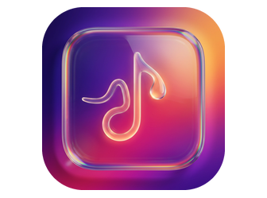

<p align="center">
  
</p>

<h1 align="center">NOVA Player</h1>

<p align="center">
  <b>An offline-first music player for Android, Linux and Windows.</b><br />
  Word-synced lyrics, album-coloured themes, a deep equalizer, and your own music library.
</p>

<p align="center">
  
  
  
</p>

> **Beta.** NOVA Player 1.0.0-beta is the first release. Expect rough edges and please report bugs.

## What it is

NOVA Player plays the music files you already own:

- Local library with albums, artists, genres, folders, playlists and smart views
- Line- and word-synced lyrics (local `.lrc`, embedded tags, or online sources), with a lyrics editor
- 18-band equalizer, AutoEQ headphone correction, ReplayGain, crossfade and gapless playback
- Several Now Playing styles, dynamic colours from the artwork, and many personalisation options
- Interface in 15 languages, including Persian (فارسی) with right-to-left layout

## Build from source

Requirements: Flutter **3.47.7** (the version used in `.github/workflows/release.yml`), Git.

```bash
git clone https://github.com/luciferee6ih/nova-player.git
cd nova-player
flutter pub get
dart run build_runner build --delete-conflicting-outputs   # only after changing Riverpod providers or Isar models
flutter analyze
flutter test
```

Run or build per platform:

```bash
# Android (GitHub flavor: updates come from GitHub releases)
flutter run --flavor github
flutter build apk --flavor github --release --split-per-abi

# Linux. Needs: clang cmake ninja-build pkg-config libgtk-3-dev libmpv-dev
flutter run -d linux
./package.sh --help        # .deb / .rpm / .AppImage / .tar.gz packaging

# Windows. Needs Visual Studio 2022+ with "Desktop development with C++"
flutter run -d windows
```

Release builds are signed with `android/key.properties` when present, otherwise with the debug key.

> Note: `appambit_sdk_flutter` 1.2.x ships a file with the wrong case
> (`AppambitSdkFlutterPlugin.kt`). On Linux/macOS hosts, rename it in your pub cache to
> `AppAmbitSdkFlutterPlugin.kt` after `flutter pub get` (the CI workflows do this automatically).
> Crash reporting through it is **off** by default; enable it only with your own key:
> `--dart-define=APPAMBIT_ENABLED=true --dart-define=APPAMBIT_APP_KEY=...`.

## Contact

- Telegram: [@theluciferee](https://t.me/theluciferee)
- Bugs and ideas: [GitHub issues](https://github.com/luciferee6ih/nova-player/issues)
- Source and releases: [github.com/luciferee6ih/nova-player](https://github.com/luciferee6ih/nova-player)

## License

NOVA Player is free software under the **GNU General Public License v3.0**. See [LICENSE](LICENSE).
